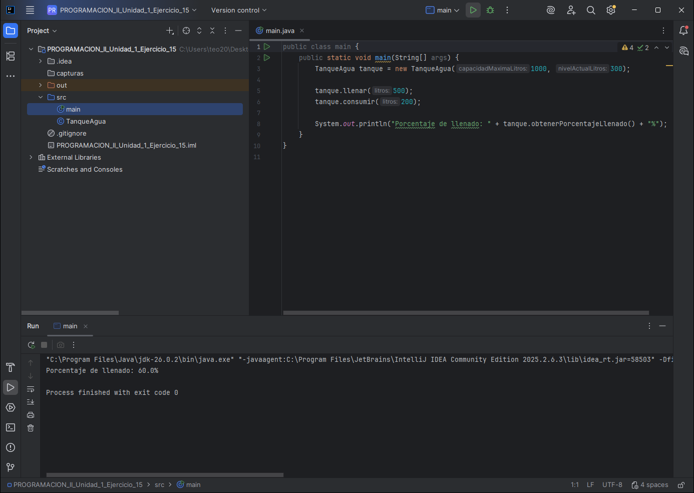

# PROGRAMACIÓN II — Unidad 1, Ejercicio 15: Monitoreo de Tanque de Agua

Trabajo práctico de Programación II. Este repositorio contiene la resolución en Java del ejercicio 15 de la Unidad 1.

## Consigna

#### Contexto

Los sistemas de almacenamiento hídrico en edificios residenciales necesitan sensores que controlen el nivel de llenado para evitar desbordes o faltantes en el suministro.

#### Consigna

Programar una clase que modele un tanque de agua inteligente con capacidad máxima y volumen actual medido en litros.

#### Desarrollo requerido

- Definir la clase TanqueAgua con los atributos capacidadMaximaLitros (double) y nivelActualLitros (double).
- Incorporar un constructor que inicialice el tanque asegurando que el nivel actual nunca supere la capacidad máxima.
- Implementar un método llenar(double litros) (que detenga o limite el llenado al llegar al máximo) y un método consumir(double litros) (verificando que haya suficiente agua).
- En el método main, instanciar el tanque, realizar operaciones de carga y consumo de agua, y mostrar el estado porcentual de llenado por consola.

## Estructura del repositorio

```
PROGRAMACION_II_Unidad_1_Ejercicio_15/
├── README.md
├── capturas/
│   └── consola.png
└── src/
    ├── main.java   # clase con el método main
    └── TanqueAgua.java
```

## Funcionamiento y lógica

### `TanqueAgua`

Modela un tanque con los atributos privados `capacidadMaximaLitros` y `nivelActualLitros`.

- **Constructor:** la capacidad tiene que ser positiva y el nivel inicial tiene que estar entre 0 y la capacidad; si no, se cargan en 0 y se informa.
- **`llenar(double litros)`:** suma litros al tanque. Si el nivel supera la capacidad máxima, lo deja justo en el máximo, así el tanque nunca desborda.
- **`consumir(double litros)`:** resta litros solo si la cantidad es positiva y hay agua suficiente.
- **`obtenerPorcentajeLlenado()`:** devuelve qué porcentaje de la capacidad está ocupado (`nivel * 100 / capacidad`).

### `main`

Crea un tanque de 1000 litros con 300 litros, carga 500 (llega a 800) y consume 200 (queda en 600). El porcentaje de llenado final es **60 %**.

## Ejecución

Captura de la consola de IntelliJ IDEA ejecutando el programa:



Salida obtenida:

```
Porcentaje de llenado: 60.0%
```
